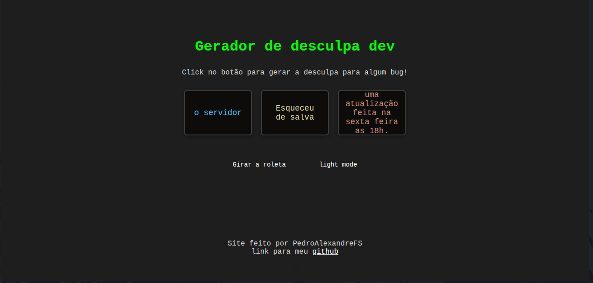
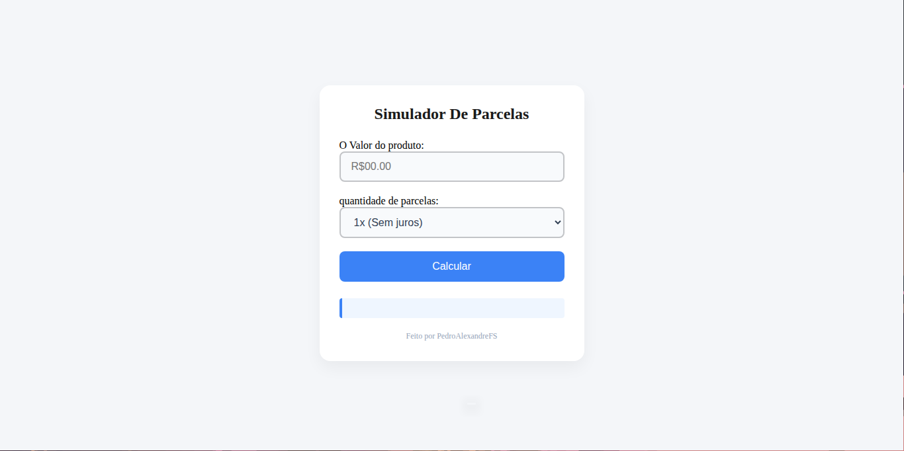
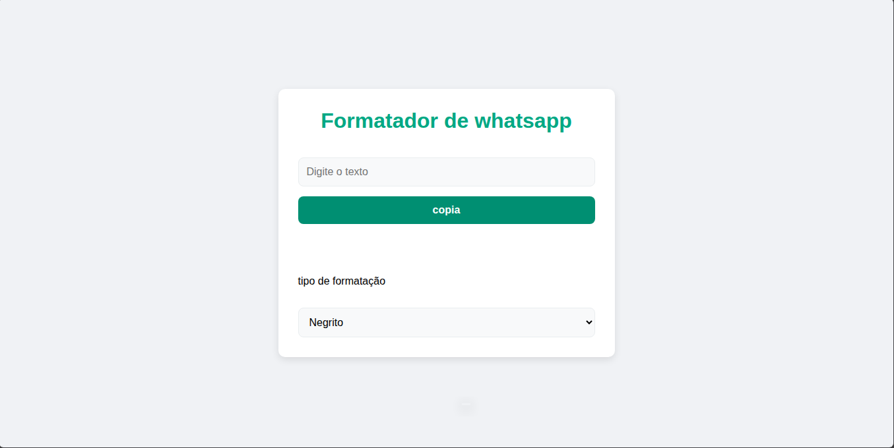
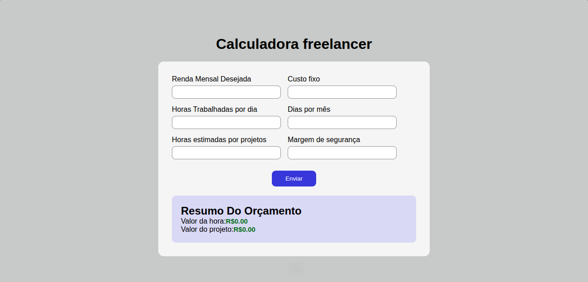

# projetos de javaScript

`DESCRIÇÃO`: esse vai ser uma lista de projetos js que estou fazendo durante meu aprendizado, projetos abaixo.

# Meus projetos:
* [gerador de Desculpa](#Gerador-de-Desculpa)
* [simulador de Parcelas](#simulador-de-parcelas)
* [Formatador de whatsApp](#Formatador-de-whatsApp)
* [Calculadora de Freelancer](#)

  # gerador de desculpa
  DESCRIÇÃO: é um site que gerar três partes  de uma frase para fazer uma desculpa usada por devs 
  link para acessar o site:[acessar o site](https://pedroalexandrefs.github.io/projetos-javaScript/Gerador-de-Desculpa)
   
   
  

   
   
# simulador de parcelas
DESCRIÇÃO: é um site que simula parcelas compostos
link para acessar o site:[acessar o site](https://pedroalexandrefs.github.io/projetos-javaScript/simulador-de-parcelas)
  

 
 
# Formatador de whatsApp
DESCRIÇÃO: é um site simples para formatação de texto para whatsApp.
link para o site:[acessar o site](https://pedroalexandrefs.github.io/projetos-javaScript/Formatador-de-whatsApp)
  

  

# Calculadora de freelancer
Descrição:calculadora para ajudar profissionais autônomos a precificar projetos
link para o site:[acessar o site](https://pedroalexandrefs.github.io/projetos-javaScript/Calculadora-Freelancer)
  
